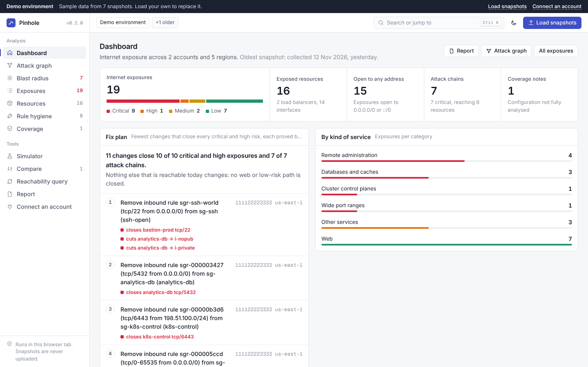
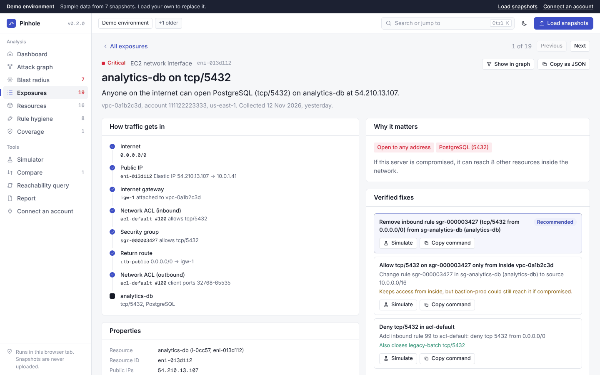
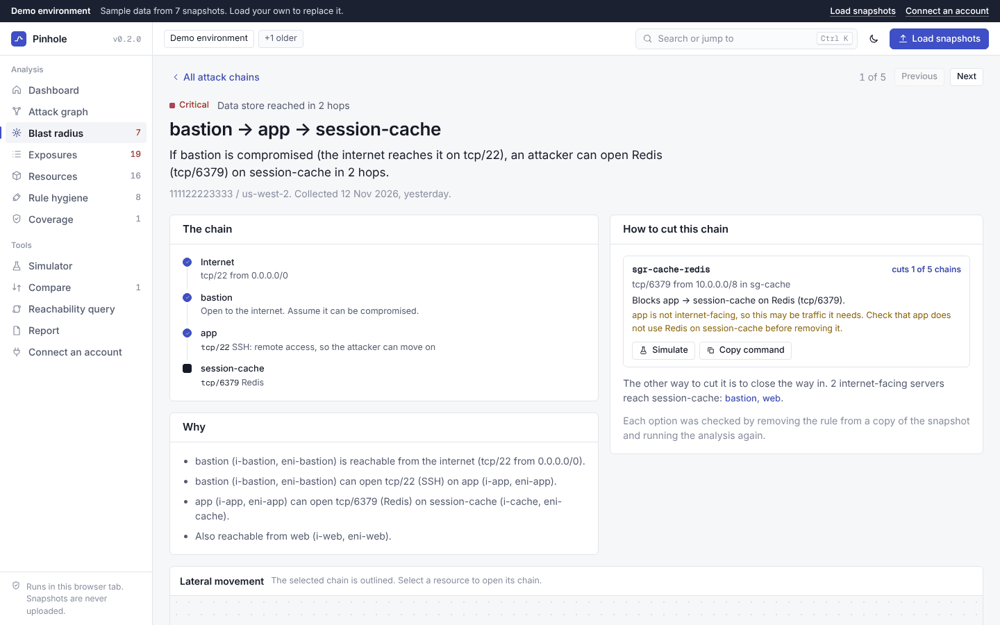

# Pinhole

**See what the internet can reach in your AWS network, what an attacker can reach next, and the fewest rule changes that close it.**

[](https://github.com/w3bcooki3/pinhole/actions/workflows/ci.yml)
[](https://w3bcooki3.github.io/pinhole/)
[](LICENSE)

**[Open the console](https://w3bcooki3.github.io/pinhole/)** · [Quick start](#quick-start) · [How it decides](#how-it-decides) · [Limitations](#limitations) · [Report a wrong result](https://github.com/w3bcooki3/pinhole/issues/new/choose)



Pinhole reads your network configuration with read-only AWS calls, saves it as a JSON snapshot, and analyses the snapshot offline: in your browser or on the command line. Nothing is uploaded, and nothing in your account is changed.

It answers three questions, exactly rather than by sampling:

1. **What can the internet open a connection to?** Every interface and load balancer listener, the exact ports and source addresses, and the rule that allowed each hop: public IP, internet gateway, network ACL in both directions, security group, return route.
2. **If one of those servers is compromised, what next?** Attack chains through SSH, RDP, cluster control planes and databases to internal resources the internet cannot reach directly.
3. **What is the smallest fix?** Each candidate change is applied to a copy of the snapshot and the analysis is run again, so every suggested fix is proved, with what else it would affect and the AWS CLI command to apply it.

## Quick start

**In the browser, nothing to install:**

1. Open **[the console](https://w3bcooki3.github.io/pinhole/)**. It starts on a labelled demo environment.
2. Choose **Connect an account** and follow the steps: one command in AWS CloudShell writes a snapshot of a region.
3. Download the snapshot from CloudShell and drop it on the console.

**On the command line** (Node.js 22 or later):

```sh
git clone https://github.com/w3bcooki3/pinhole.git && cd pinhole
npm ci && npm run build
node packages/cli/dist/main.js collect --profile audit --region eu-west-1
node packages/cli/dist/main.js exposure pinhole-snapshot-*.json
```

<table>
<tr>
<td width="50%"></td>
<td width="50%"></td>
</tr>
<tr>
<td>Each exposure: a plain verdict, the exact path, and verified fixes.</td>
<td>Each attack chain: the route, why it works, and what cuts it.</td>
</tr>
</table>

<!-- fixture-count:start -->
**Fixtures: 55 of 55 assertions pass across 10 scenarios.** Generated by `npm run fixture-count`; CI fails if this line is out of date.
<!-- fixture-count:end -->

## What it reports

For every network interface with a public IP and every internet-facing ALB/NLB listener, Pinhole reports:

- the protocol and the exact port range a client on the internet can open a connection to;
- the exact set of source addresses that work, and the security group rules that let them in;
- whether responses can get back to the client, per client operating system (NACLs are stateless, so this depends on the outbound ephemeral port rules);
- the full path with the resource and rule that decided each step: public IP, internet gateway, NACL rule numbers in both directions, security group rule IDs, the route entry used for the response;
- for load balancers, which targets behind each listener are reachable from the load balancer nodes, and where the others are blocked.

Findings are ordered by risk: remote administration ports (SSH, RDP, ...), databases and cluster control planes first, then admin panels, then everything else, then plain HTTP/HTTPS.

Example, from [fixture 07](fixtures/07-alb-private-targets):

```
[LOW] tcp/443
  resource: ALB web
  arn:      arn:aws:elasticloadbalancing:us-east-1:111122223333:loadbalancer/app/web/0123456789abcdef
  public:   52.0.1.50, 52.0.2.50
  allowed:  0.0.0.0/0
  sources:  0.0.0.0/0 (every internet address)
  return:   return traffic allowed for all client port ranges
  path (sample client 1.0.0.0):
      note                  internet-facing application load balancer web, listener HTTPS:443
      public IP        ok   public IP 52.0.1.50 -> 10.0.1.50
      internet gateway ok   igw-1 attached to vpc-1
      NACL in          ok   acl-public inbound rule 100 allows tcp/443 from 1.0.0.0
      security group   ok   inbound tcp/443 from 1.0.0.0 allowed by sgr-alb-https (sg-alb)
      return route     ok   rtb-public: 0.0.0.0/0 -> igw-1
      NACL return      ok   acl-public outbound to 1.0.0.0: ports 32768-65535 of 32768-65535 allowed (rules 100)
  target i-app1 (10.0.10.11) port 8080: reachable (2/2 load balancer nodes)
  target i-app2 (10.0.10.12) port 8080: blocked (0/2 load balancer nodes) at security group: no inbound rule in sg-app-wrong allows tcp/8080 from 10.0.1.50
```

## Use it without installing anything

Pinhole has no server and no backend. The console is a single static HTML page that runs in your browser.

1. Open the console at [w3bcooki3.github.io/pinhole](https://w3bcooki3.github.io/pinhole/), download `pinhole-<version>.html` from a [release](https://github.com/w3bcooki3/pinhole/releases) and open it from disk, or build it yourself with `npm run build:web`.
2. Follow **Connect an AWS account**. It walks you through six steps in AWS CloudShell, with copy-ready commands:
   1. Open CloudShell in the account and region to check.
   2. Paste one command that writes `cloudshell-collect.sh` into CloudShell (or upload the file).
   3. Run `bash cloudshell-collect.sh <region>`, or a loop over several regions.
   4. Download each `pinhole-snapshot-<account>-<region>.json` with Actions > Download file, using the path the script prints.
   5. Drop the files on the console.
   6. Optionally, remove the files from CloudShell.
3. Use the console. It opens on a demo environment, labelled as such, until you load your own snapshots.
   - **Dashboard:** internet exposures by severity, a verified fix plan (the fewest rule changes that close every critical and high exposure and attack chain, with what each step closes and its AWS CLI command), exposures by kind of service, the top exposures and attack chains, and exposures per account and region.
   - **Attack graph:** internet, entry point (internet gateway or load balancer), exposed resource and load balancer targets, grouped by account, region and VPC. Pan, zoom, filter by severity and highlight a resource.
   - **Blast radius:** if a server the internet can reach is compromised, what the attacker can reach next, as a graph of hops with the selected chain traced end to end. Each chain lists the rules that cut it, ranked by how many chains each one cuts.
   - **Exposures:** every service the internet can open a connection to, in a filterable table. Each one opens as a page with a plain verdict, the path hop by hop, verified fixes, attack chains that start there, and what the analysis could and could not see. Selecting one shows each hop with the exact rule that allowed it, the targets behind a listener, and verified fixes with their AWS CLI commands.
   - **Resources** and **Rule hygiene:** exposed resources, and rules that are redundant, shadowed, stale, unused or too broad. Rules already shown as exposures are left off the hygiene list unless you ask for them.
   - **Simulator:** switch rules off, edit them or drop public IPs, and see which internet paths and attack chains close or open. It prints the AWS CLI commands and can export the changes for `pinhole whatif --changes`.
   - **Compare snapshots:** load an older snapshot of the same account and region next to the current one to see new and closed internet exposure and attack chains, and the rule, route and address changes behind them. Every other page uses only the latest snapshot of each account and region.
   - **Reachability query:** "can A reach B, on what" and "who can reach B", by name, ID or IP.
   - **Coverage:** what each snapshot contained, and anything detected that this version does not analyse.
   - **Report:** everything on one page for people who will not open the console. Print it or save it as a PDF, or download it as a single HTML file with no script.

   Press Ctrl+K (Cmd+K on a Mac) or / to jump to any page, exposure, chain or resource. Export exposures as JSON or CSV. The console is light by default; the moon button switches to dark and the choice is remembered in this browser.

The page reads files locally. It makes no network requests, and its Content Security Policy makes the browser enforce that. Several snapshots, across accounts and regions, can be loaded at once.

To publish the console from your fork: Settings > Pages > Source: "GitHub Actions". The [`pages`](.github/workflows/pages.yml) workflow then tests, builds and publishes on every push to `main`. GitHub Pages and Actions are free for public repositories.

## Command-line use

Requirements: Node.js 22 or later.

```sh
git clone https://github.com/w3bcooki3/pinhole.git
cd pinhole
npm ci
npm run build
alias pinhole="node $PWD/packages/cli/dist/main.js"
```

### 1. Collect a snapshot

Either from your machine, with any AWS profile that has the [minimal policy](docs/iam-policy.json):

```sh
pinhole collect --profile audit --region eu-west-1
# writes pinhole-snapshot-<account>-eu-west-1.json (file mode 0600)

pinhole collect --profile audit --region us-east-1,eu-west-1,ap-southeast-2 --out-dir snapshots
# one file per region; a region that fails does not stop the others
```

Or in AWS CloudShell, without installing anything. Upload [`scripts/cloudshell-collect.sh`](scripts/cloudshell-collect.sh) and run:

```sh
bash cloudshell-collect.sh eu-west-1
```

Then download the file (Actions > Download file).

A snapshot covers one account and one region; `--region` takes a comma-separated list to collect several in one run.

### 2. Analyse it

```sh
pinhole exposure pinhole-snapshot-111122223333-eu-west-1.json
pinhole exposure snapshot.json --min-severity high       # hide low/medium/info
pinhole exposure snapshot.json --format json > report.json
pinhole exposure snapshot.json --fail-on critical        # exit code 2 if any critical finding
pinhole validate snapshot.json                           # counts and out-of-scope warnings
```

### 3. Go further

```sh
# Can one resource reach another, and on what? Names, IDs and IPs all work.
pinhole can snapshot.json --from bastion --to orders-db
pinhole can snapshot.json --from i-0abc --to 10.0.3.10 --port 5432
pinhole can snapshot.json --from internet --to web

# What an attacker reaches after taking over each internet-facing resource
pinhole blast snapshot.json --min-severity high
pinhole blast snapshot.json --fail-on critical

# The smallest verified change that closes each finding, as AWS CLI commands
pinhole fix snapshot.json                 # critical and high findings
pinhole fix snapshot.json --all           # every candidate, not just the best

# Redundant, shadowed, stale, unused and overly broad rules
pinhole hygiene snapshot.json

# Before and after, without touching AWS
pinhole whatif snapshot.json --revoke sgr-0123 --remove-nacl acl-0abc#ingress#120
pinhole whatif snapshot.json --changes proposed.json
```

### 4. Track changes and use it in pipelines

```sh
# What changed since last week: new and closed exposure and chains, and the rule changes behind them
pinhole diff last-week.json today.json
pinhole diff last-week.json today.json --fail-on high          # exit code 2 on anything new at high or above
pinhole diff last-week.json today.json --format markdown       # for a ticket or a pull request comment

# Findings for GitHub code scanning (upload with GitHub's upload-sarif action) or as a Markdown table
pinhole exposure snapshot.json --format sarif > pinhole.sarif
pinhole exposure snapshot.json --format markdown
```

### 5. Check a Terraform plan before you apply it

```sh
terraform plan -out tfplan && terraform show -json tfplan > plan.json
pinhole plan snapshot.json plan.json                      # what the plan opens and closes
pinhole plan snapshot.json plan.json --fail-on high       # exit code 2 if it opens anything high or above
```

Pinhole places each security group, security group rule, network ACL, route, security group attachment and Elastic IP association change from the plan onto the snapshot and runs the full analysis. Changes it cannot place exactly, such as rules on a security group the same plan creates, are listed under "Not analysed" with the reason, never guessed. See [docs/model.md](docs/model.md#terraform-plans) for what is covered.

SARIF results carry a stable fingerprint per exposed service, so code scanning keeps one alert per exposure across runs and closes it when the exposure goes away.

`fix` and `whatif` never change anything. They print `aws ec2 ...` commands for you to review and run. See [docs/model.md](docs/model.md#lateral-movement) for how chains, fixes and hygiene are decided.

Exit codes: 0 success, 1 usage or input error, 2 the `--fail-on` threshold was reached.

## GitHub Actions

Use Pinhole in another repository's workflow. It reads files in the workspace and never calls AWS; collect the snapshot in an earlier step or keep a recent one in the repository.

```yaml
- uses: actions/checkout@v4
- run: terraform plan -out tfplan && terraform show -json tfplan > plan.json
- uses: w3bcooki3/pinhole@v0.2.0
  with:
    command: plan                       # exposure, diff or plan
    snapshot: snapshots/prod-us-east-1.json
    plan: plan.json
    fail-on: high                       # fail the job on new exposure at high or above
```

The result is written to the job summary as a table. For `command: exposure`, set `sarif: pinhole.sarif` and upload the file with GitHub's `upload-sarif` action to see findings under the repository's Security tab. For `command: diff`, set `baseline` to the older snapshot. Pin the action to a release tag or commit SHA.

## Permissions

The collector needs exactly the 26 read-only actions in [`docs/iam-policy.json`](docs/iam-policy.json): `ec2:Describe*` calls for VPCs, subnets, route tables, gateways, peering, transit gateways, NACLs, security groups (and their rules), prefix lists, interfaces, instances and VPC endpoints; `ec2:SearchTransitGatewayRoutes` and `ec2:GetManagedPrefixListEntries`; and `elasticloadbalancing:Describe*` for load balancers, listeners, rules, target groups, target health and target group attributes. `sts:GetCallerIdentity` needs no permission.

A test checks that this policy and the collector's list of API calls match exactly. The collector also refuses at runtime to send any operation whose name does not start with `Describe`, `Get` or `Search`.

If a call is denied, collection continues. The failure is recorded in the snapshot's `errors` field, and the report warns that results depending on it may be incomplete.

## How it decides

The engine models documented AWS behaviour and cites the documentation in code comments, fixtures and findings. [docs/model.md](docs/model.md) lists every behaviour v1 models, with links, and every simplification.

In short:

- **Security groups**: allow-only, rules from all groups on an interface are OR'ed, stateful (only the opening direction is checked). Sources can be CIDRs, prefix lists, or security groups. A group reference matches the private IPs of member interfaces only, so it never matches internet traffic.
- **Network ACLs**: stateless, lowest rule number first, first match wins, `*` denies. Responses are checked against the client's ephemeral ports: Linux kernels use 32768-61000, Windows Server 2008 and later 49152-65535, Elastic Load Balancing 1024-65535. Traffic between two interfaces in the same subnet is not filtered by the NACL.
- **Routing**: longest prefix match, then static over prefix-list over propagated. Blackhole routes drop traffic. Peering is non-transitive. Transit gateway routing uses the attachment's associated route table, the AZ coverage of the attachment, and the NACL evaluation rules for attachment subnets.
- **Internet exposure** over IPv4 needs all of: a public IP or Elastic IP; an internet gateway attached to the VPC; NACL and security group rules allowing the request; the subnet's route for the client pointing at that internet gateway; and the NACL allowing the response.
- **Load balancers**: internet to listener through the load balancer's own NACLs and security groups, then each load balancer node to each target on the target port. NLB client IP preservation is taken into account.

Exposure analysis is exact, not sampled. The address and port space is cut at every boundary of every relevant rule, so each piece behaves uniformly. One packet per piece is then evaluated.

Verdicts are `reachable`, `blocked`, or `unknown`. `unknown` means the snapshot lacks what the answer depends on, for example a route table in another account or an appliance in the path. It never means the tool guessed.

## Correctness

Every evaluation rule has unit tests, written before the implementation. On top of those, the [`fixtures/`](fixtures) directory holds hand-written snapshots with expected answers. Each fixture has a README explaining the scenario and linking the AWS documentation that justifies the answer:

| Fixture | Behaviour |
|---|---|
| [01](fixtures/01-nacl-ephemeral-return) | NACL return traffic on ephemeral ports: full, partial (Linux range only), none |
| [02](fixtures/02-sg-to-sg-reference) | Security group references match members only, never internet clients |
| [03](fixtures/03-longest-prefix-routes) | Longest-prefix routing combined with non-transitive peering |
| [04](fixtures/04-blackhole-routes) | Blackhole routes in a VPC route table and a transit gateway route table |
| [05](fixtures/05-peering-no-return-route) | Peering where the far side has no route back |
| [06](fixtures/06-public-ip-without-igw-route) | Public IP or Elastic IP without an internet gateway route |
| [07](fixtures/07-alb-private-targets) | Internet-facing ALB in front of private instances |
| [08](fixtures/08-nlb-client-ip-preservation) | NLB without security groups; client IP preservation on and off |
| [09](fixtures/09-lateral-movement) | Attack chains, merged per target; the best fix; what a change closes and leaves open |
| [10](fixtures/10-ipv6-exposure) | IPv6 without a public IP; egress-only gateways; network ACL IPv6 rules and return ports |

CI runs every test and fixture on each push, on Node 22 and 24. It also runs both collectors (SDK and CloudShell script) against a fake AWS backed by the fixtures.

```sh
npm test                 # everything
npm run test:fixtures    # fixtures only
npm run fixture-count    # refresh the count at the top of this file
```

To add a fixture, create `fixtures/NN-name/` with `snapshot.json`, `expected.json` (see existing ones for the format) and a `README.md` that cites the AWS documentation.

## Limitations

Read these before relying on a clean report.

- **Scope is VPC network paths to interfaces and Application/Network Load Balancers.** Services that are public by design and not reached through a VPC interface are not covered: S3 buckets, API Gateway, Lambda function URLs, CloudFront distributions, public RDS snapshots, and so on. Use a configuration scanner such as Prowler or AWS Security Hub alongside Pinhole for those.
- **IPv6** exposure of network interfaces is analysed for TCP and UDP, exactly, the same way as IPv4: an IPv6 address needs no public IP, so any interface with one in a subnet routed to an internet gateway is checked. Not analysed for IPv6: ICMPv6, load balancer listeners (dual-stack load balancers are flagged in Coverage), prefix lists with IPv6 entries, IPv6 lateral movement, and IPv6 rules in Terraform plans. The IPv6 internet is taken to be global unicast space (`2000::/3`) outside the VPC's own IPv6 blocks.
- **Not modelled, detected and warned about:** AWS Network Firewall, Gateway Load Balancer, routes to appliances (ENI or instance targets), gateway route tables (ingress routing on the internet gateway), Global Accelerator, CloudFront, Classic Load Balancers, VPN and Direct Connect paths. Results that pass through these are `unknown`, or incomplete where only a warning is possible.
- **One account and one region per snapshot.** Peering or transit gateway paths into another account or region end as `unknown`. Transit gateway route tables shared from another account cannot be searched from the attachment owner's account.
- **Configuration, not traffic.** The snapshot is a point in time. Existing connections can outlive a rule change, because security groups track connections. Host firewalls, the OS, and whether anything is listening on the port are outside the model.
- **Transit gateway ECMP** (several attachments for one route) follows the first attachment. Appliance mode is not modelled.
- **Load balancers:** health check reachability is not evaluated when the health check port differs from the traffic port. Lambda and ALB-as-target targets are reported as `unknown`. Listener rules are only used to find target groups; host or path conditions are not evaluated.
- **NLB client IP preservation:** the return route from the target is assumed to go back through the load balancer, and is not checked.
- **Security groups that cannot block traffic:** traffic to the Route 53 Resolver (VPC+2) is not filtered by security groups or NACLs. It is not internet exposure, and it is not reported.
- **Address ranges:** the RFC 5737 documentation ranges (`192.0.2.0/24`, `198.51.100.0/24`, `203.0.113.0/24`) count as internet addresses, so they can stand in for clients in fixtures. Private, loopback, link-local, CGNAT and multicast space never count as internet sources.
- **Large transit gateway route tables:** a route table with more than 1000 matching routes cannot be read in one call. It is left out and paths through it are `unknown`, rather than being analysed from a partial list.
- **Size:** the web console refuses files over 200 MB and analyses in the browser tab, so very large accounts are better analysed with the CLI. As a rough guide, a synthetic snapshot with 3,000 public interfaces and 300 security groups of 40 rules each takes about 16 seconds and 1 GB of memory in the CLI; real accounts usually expose far fewer ports per interface and run much faster.
- **Risk ranking** is a fixed port list (`packages/engine/src/risk.ts`). It does not know what actually runs on a port.

## Repository layout

```
packages/engine/     Pure TypeScript, no I/O, no AWS SDK. Snapshot format, normaliser,
                     SG/NACL/route evaluation, path walk, exposure. Runs in Node and browsers.
packages/collector/  Read-only collector (AWS SDK v3) behind an injectable send function.
packages/cli/        The `pinhole` command.
packages/web/        Static web page (one HTML file, engine bundled in, no network access).
scripts/             CloudShell collector script; web page build; fixture count updater.
fixtures/            Hand-written scenarios with expected answers and AWS doc links.
docs/                Model description, minimal IAM policy.
```

The engine has no dependencies so that it can later share a core with IAM Lens (an IAM policy analyser) as one AWS toolkit.

## Roadmap

- **M1 (0.1, done):** snapshot collection, SG/NACL/route/TGW/peering/load balancer engine, internet exposure report.
- **M2 (0.2, done):** `pinhole can`, rule hygiene, blast radius and attack chains, verified fixes, what-if simulation, in the CLI and the console.
- **M3 (0.2, done):** Terraform plan check, snapshot diff, SARIF and Markdown output, and a GitHub Action that fails pull requests that open new internet exposure.
- **Next:** IPv6 for load balancers and lateral movement, IPv6 in Terraform plans, and more AWS services in plans (load balancers, subnets).
- **M4:** attack chains that cross accounts through peering and transit gateways when snapshots of both sides are loaded.

## Security

See [SECURITY.md](SECURITY.md) for how to report a vulnerability and what the tool does to protect your data. In short:

- Collection is read-only and enforced three ways: the IAM policy lists only `Describe*`, `Get*` and `Search*` actions, the SDK collector imports only those commands, and it refuses any operation name that is not read-only.
- Snapshots describe your network in detail. Treat them as sensitive. The CLI and the CloudShell script write them with file mode 0600, `.gitignore` excludes `*snapshot*.json`, and they should not be attached to public issues.
- The web console makes no network requests. Its Content Security Policy allows only its own inline script, by hash, and blocks all connections; snapshot text is only ever inserted as text.

## Contributing

Wrong results are the most useful thing to report: open an [issue](https://github.com/w3bcooki3/pinhole/issues/new/choose) with a small hand-written snapshot that shows it, never a real one. See [CONTRIBUTING.md](CONTRIBUTING.md) for setup and the rules for changes, and the [code of conduct](CODE_OF_CONDUCT.md).

Releases are published from version tags with the console as one HTML file, the CloudShell script, the IAM policy and SHA-256 checksums. See [CHANGELOG.md](CHANGELOG.md) for what changed.

## Licence

MIT. See [LICENSE](LICENSE).
